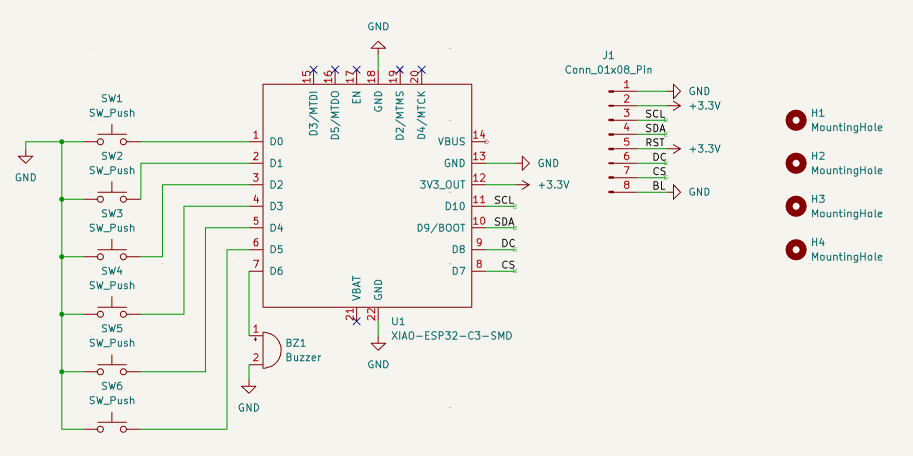
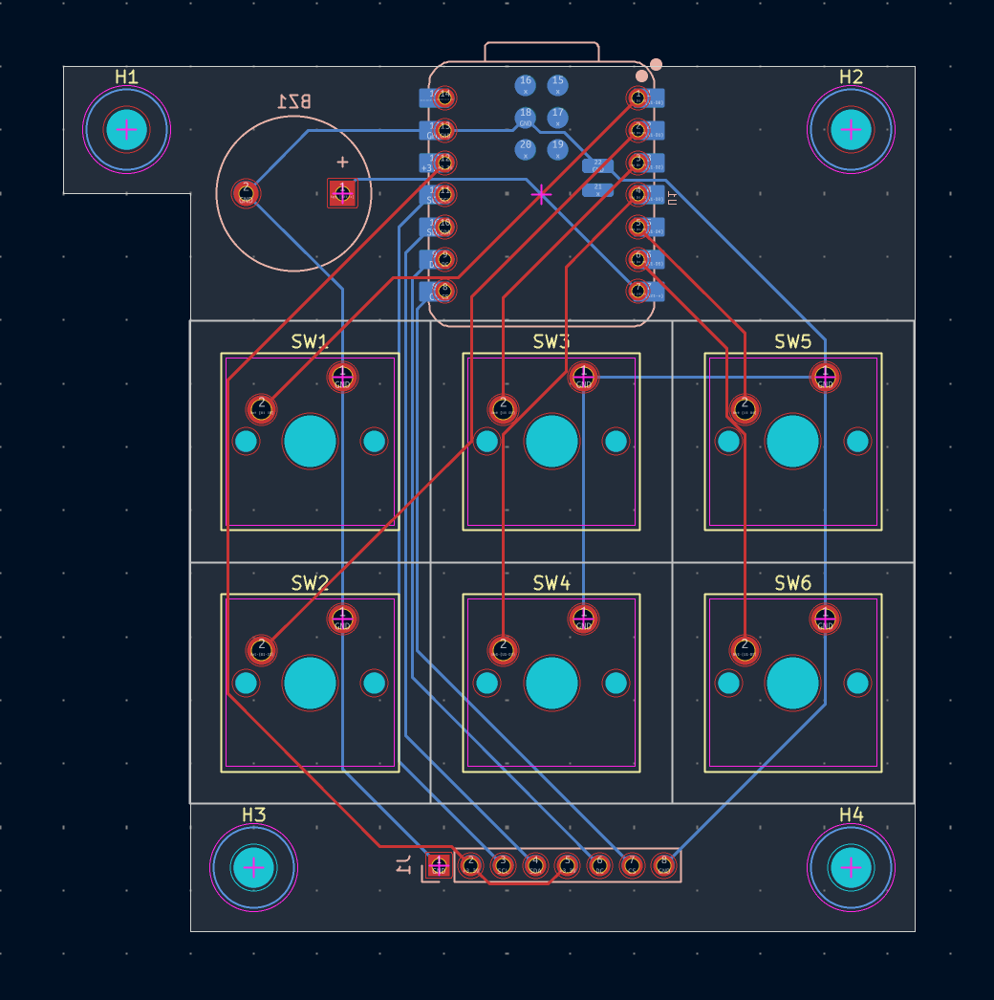
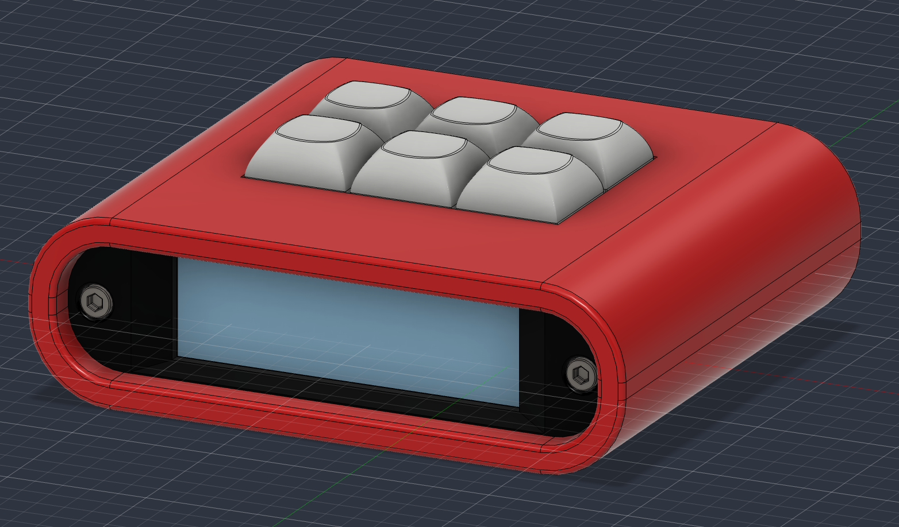

# Kira BLARE Clock

A 6-key alarm clock with a wide 2.25" screen and a buzzer that won't let you go back to sleep. To turn the alarm off you have to type a random code. I built the PCB, case and firmware from scratch.

## Features

- Big 7-segment style clock with seconds, the date, and the alarm status
- Gets the time from the internet over WiFi (NTP), with automatic daylight saving
- The alarm can repeat every day, on weekdays, on weekends, or ring once, and it has a snooze
- **Stop code:** to stop the alarm you type a random key sequence shown on the screen
- Night mode dims the digits to red so the clock doesn't light up the room
- Runs on a Seeed XIAO ESP32C3 with Arduino firmware

## Hardware

- Controller: Seeed XIAO ESP32C3
- Display: 2.25" ST7789 TFT (76x284), SPI
- Switches: 6x MX-style, each wired straight to a GPIO
- Buzzer: 3.3V piezo
- Connector: 8-pin header for the screen, which is wired off the PCB with jumper wires

## PCB

Designed in KiCad. It's a simple 2-layer board (67 x 68 mm) with the switches on the front and the XIAO, buzzer and screen header on the back, inside the case. There's no matrix, so the board needs no diodes. The source files are in [`pcb/`](pcb/): schematic, layout and STEP export.

## Case

Designed in Fusion 360. It's made of four printed parts (front, back, base and case) held together with M3 screws and heat-set inserts. The full assembly is in [`cad/blare.step`](cad/), and each printable part is in [`production/`](production/).

## Firmware

The firmware is an Arduino sketch in [`firmware/`](firmware/). Setup, pins and troubleshooting are in [`firmware/README.md`](firmware/README.md).

### Keymap

| | | |
|-|-|-|
| [1] Menu | [2] Up   | [3] Alarm on/off  |
| [4] Back | [5] Down | [6] OK / Snooze   |

When the alarm rings, **OK** snoozes it. Any other key brings up the stop code: the screen shows a random sequence like `5 2 6 1`, and you type it on the keys, which are numbered 1-6 from left to right, top to bottom. A wrong key gives you a new code.

### Flash

1. Install the [Arduino IDE](https://www.arduino.cc/en/software/) and the ESP32 boards ([Seeed guide](https://wiki.seeedstudio.com/XIAO_ESP32C3_Getting_Started/)).
2. Install the **Adafruit ST7735 and ST7789** and **Adafruit GFX** libraries from the Library Manager.
3. Copy `firmware/secrets.example.h` to `secrets.h` and add your WiFi name and password.
4. Open `firmware/blare.ino`, select **XIAO_ESP32C3**, and click Upload.

### Customizing

- Key functions: change the `KEY_*` lines in `firmware/config.h`.
- Time zone, colours, night hours, buzzer tone: `firmware/config.h`.
- Alarm sound: edit `ALARM_PATTERN` in `firmware/blare.ino`.

## Built with

- KiCad (PCB)
- Fusion 360 (case)
- Arduino + Adafruit GFX (firmware)

## Inspiration

I built this by following Hack Club's [BLARE](https://blare.hackclub.com/docs) guide.

## Author

Made with ❤️ by [@kira-iovenko](https://github.com/kira-iovenko)
